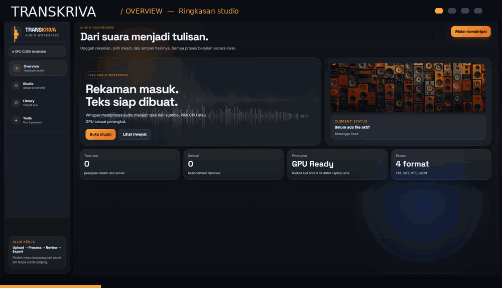
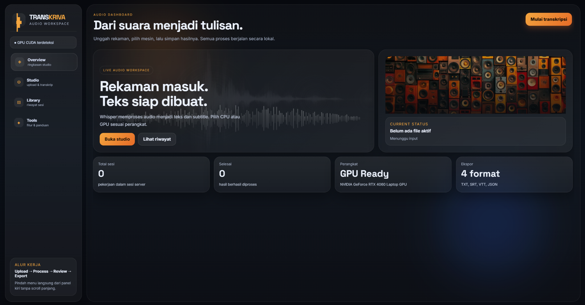
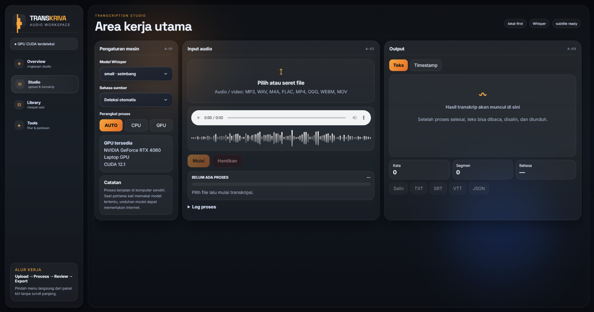
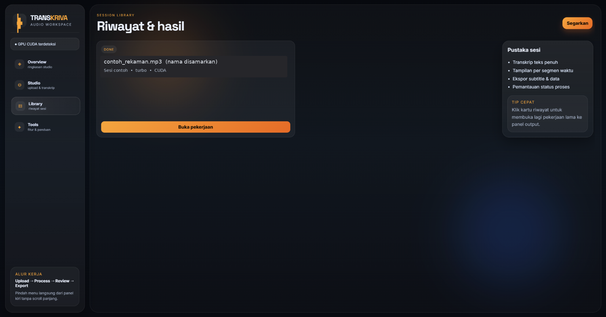
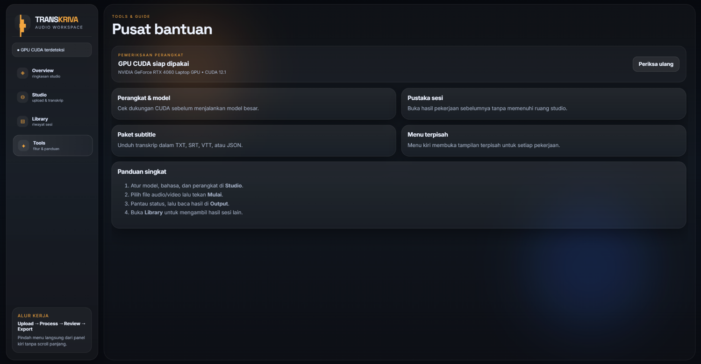

<div align="center">

# TRANSKRIVA

**Local Audio Transcription Workspace**

Python · OpenAI Whisper · HTML/CSS/JavaScript · Local-first



**Four focused views. One local transcription workflow.**

</div>

---

## Tentang proyek

**Transkriva** adalah aplikasi web **lokal** untuk mengubah audio atau video menjadi teks menggunakan OpenAI Whisper. Backend Python berjalan di komputer sendiri, sedangkan halaman web dibuka lewat browser pada `http://127.0.0.1:5000`.

Navigasi sidebar membuka panel **Overview**, **Studio**, **Library**, dan **Tools** tanpa berpindah lewat scroll panjang. Tema gelap-oranye menggunakan **dua foto audio** sebagai latar, dengan dropdown Model Whisper dan Bahasa yang memiliki tampilan gelap custom.

> **Privasi:** paket publik ini tidak menyertakan rekaman pengguna, transkrip pribadi, token, `.env`, hasil pemrosesan, atau file temporary. Screenshot Library telah disamarkan. Ini tetap **aplikasi lokal**, bukan layanan transkripsi publik yang dihosting lewat GitHub Pages.

## Preview aplikasi

<table>
<tr>
<td width="50%"><b>Overview</b><br/></td>
<td width="50%"><b>Studio</b><br/></td>
</tr>
<tr>
<td width="50%"><b>Library</b><br/></td>
<td width="50%"><b>Tools</b><br/></td>
</tr>
</table>

<sub>Screenshot berasal dari aplikasi yang dijalankan secara lokal. Nama berkas dan detail sesi pada screenshot Library telah diganti untuk melindungi privasi.</sub>

## Fitur utama

| Menu | Fungsionalitas |
| --- | --- |
| **Overview** | Ringkasan sesi, status pemrosesan, kesiapan perangkat, pintasan ke Studio/Library. |
| **Studio** | Upload audio/video, pilih model Whisper, bahasa, Auto/CPU/GPU, mulai/hentikan proses, lihat teks/timestamp, ekspor hasil. |
| **Library** | Daftar pekerjaan selama server berjalan, status pekerjaan, membuka kembali hasil. |
| **Tools** | Pemeriksaan GPU CUDA, panduan singkat, informasi perangkat dan format hasil. |

**Format keluaran:** TXT, SRT, VTT, JSON. **Model Whisper:** `tiny`, `base`, `small`, `medium`, `turbo`. **Bahasa:** otomatis, Indonesia, Inggris.

Catatan: teks ditampilkan setelah proses Whisper selesai; progress ketika berjalan adalah indikator aktivitas, bukan estimasi persentase yang presisi. Di halaman Library, daftar sesi tersimpan selama server aktif, bukan database permanen.

## Instalasi & menjalankan

1. Pastikan Python dan pip tersedia. Instalasi `torch`/`openai-whisper` memerlukan versi Python yang kompatibel. Untuk GPU NVIDIA, gunakan build PyTorch dengan dukungan CUDA yang sesuai sistem.
2. Clone repository lalu masuk ke folder proyek:

   ```powershell
   cd Transkriva_Web
   ```

3. (Disarankan) Buat virtual environment:

   ```powershell
   py -m venv .venv
   .venv\Scripts\activate
   ```

4. Pasang dependensi:

   ```powershell
   python -m pip install -r requirements.txt
   ```

5. Jalankan server:

   ```powershell
   python server.py
   ```

6. Buka **http://127.0.0.1:5000** lalu pilih menu **Studio**.

Jika muncul `ModuleNotFoundError: No module named 'whisper'`, pasang ulang `openai-whisper` di **environment Python yang sama** dengan yang menjalankan server. Unduhan model Whisper pada pemakaian pertama membutuhkan internet. Untuk model besar atau akselerasi GPU, kebutuhan RAM/VRAM dan dukungan CUDA dapat berbeda-beda.

## Struktur repository

```text
Transkriva_Web/
├── server.py                  # Web server lokal dan API
├── worker.py                  # Proses transkripsi Whisper
├── exporter.py                # Format hasil
├── JALANKAN_WEB.bat           # Shortcut Windows
├── requirements.txt
├── .gitignore
├── SECURITY.md
├── README.md
├── static/
│   ├── index.html
│   ├── style.css
│   ├── app.js
│   └── images/
│       ├── waveform.jpg
│       └── speakers.jpg
└── docs/
    └── screenshots/
        ├── transkriva-tour.gif
        ├── overview.png
        ├── studio.png
        ├── library.png
        └── tools.png
```

**Folder `uploads/` dan `outputs/` dibuat otomatis saat program berjalan dan diabaikan Git.** Jangan commit file audio nyata, teks transkrip, model hasil unduhan, atau konfigurasi pribadi.

## Keamanan & privasi

- Server secara default hanya mendengarkan di `127.0.0.1` (localhost), bukan internet publik.
- Dependensi frontend tidak memuat Google Fonts; font memakai font sistem untuk menghindari request eksternal yang tidak diperlukan.
- File audio/transkrip tetap disimpan secara **lokal** di `uploads/` dan `outputs/`; aplikasi **tidak menghapusnya secara otomatis**. Hapus secara manual jika sudah tidak dibutuhkan.
- Respons web membatasi origin dari halaman lain untuk permintaan POST, menggunakan beberapa header keamanan, dan menyamarkan absolute path lokal pada log yang dikirim ke UI.
- `.gitignore` melindungi file umum yang sensitif dari `git add .`, tetapi **bukan jaminan** bila file pernah di-commit sebelumnya. Selalu periksa daftar file sebelum Push.
- Lihat [SECURITY.md](SECURITY.md) sebelum memublikasikan perubahan tambahan.

---

<div align="center"><sub>Transkriva • Local-first transcription with a focused sidebar workspace.</sub></div>
